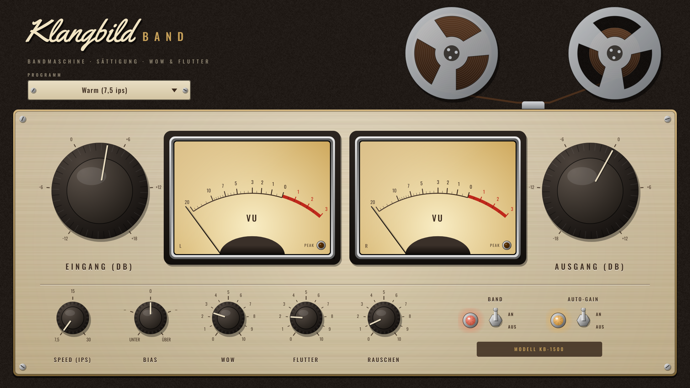

# Klangbild Band

Bandmaschinen-Emulation im Stil der großen Studio-Zweispur- und Mehrspurmaschinen: Sättigung,
Kopfresonanz, Höhenverlust, Wow & Flutter und Bandrauschen. Audio Unit für Logic Pro (außerdem VST3
und Standalone), gebaut mit [JUCE](https://juce.com).



## Bedienung

| Regler | Wirkung |
|---|---|
| **Eingang** | Wie stark das Band „angefahren“ wird (−12 … +18 dB) – mehr = mehr Sättigung und Kompression |
| **Ausgang** | Pegel nach dem Band (−18 … +12 dB) |
| **Speed** | 7,5 ips: warm, rund, früh gesättigt · 15 ips: Studio-Klassiker · 30 ips: offen, straffer Bass |
| **Bias** | Unter: mehr Verzerrung, heller · Über: sauberer, etwas dunkler |
| **Wow** | langsame Tonhöhenschwankung (Bandlauf, Spulen) |
| **Flutter** | schnelles Flattern (Tonrolle, Andruckrolle) |
| **Rauschen** | Bandrauschen, bei langsamem Band lauter |
| **Band An/Aus** | weicher Bypass, zeitrichtig ausgeglichen; aus = Signal bitgenau |
| **Auto-Gain** | gleicht den Eingangsregler am Ausgang aus – du hörst nur die Klangfärbung, nicht „lauter“ |

Die beiden VU-Meter zeigen den Ausgang links/rechts (0 VU = −18 dBFS). Die Spulen drehen sich,
solange Audio durch das Band läuft – passend zur gewählten Geschwindigkeit.

Intern läuft das Band mit doppelter Samplerate (Oversampling), die Sättigung zusätzlich mit
Anti-Aliasing – auch kräftig angefahren entstehen keine unschönen Spiegelfrequenzen.

### Presets
Standard (15 ips) · Warm (7,5 ips) · Studio (30 ips) · Summe veredeln · Drums anfahren ·
Gitarre & Bass dick · Lo-Fi Demo-Band

### Messwerte (48 kHz)
**Klirrfaktor 1 kHz** (15 ips, Bias 0): 0,8 % bei −18 dBFS (0 VU) · 2,3 % bei −12 · 6,4 % bei −6 · 13 % bei 0 dBFS

**Frequenzgang** (−30 dBFS, relativ zu 1 kHz):

| | 30 Hz | 60 Hz | 110 Hz | 10 kHz | 15 kHz | 20 kHz |
|---|---|---|---|---|---|---|
| 7,5 ips | +1,8 | +2,5 | +0,6 | −2,8 | −8,8 | −17,6 |
| 15 ips | 0,0 | +2,3 | +1,2 | −0,6 | −1,8 | −4,5 |
| 30 ips | −2,5 | +1,1 | +1,7 | −0,5 | −1,2 | −2,3 |

**Gleichlauf**: Standard (15 %/15 %) ±0,07 % – wie eine gut gewartete Studiomaschine; 100 % ≈ ±0,5 %.
**Latenz**: 2,6 ms (wird an Logic gemeldet und automatisch ausgeglichen).

## Tipps
- **Auf jeder Spur leicht, statt einmal kräftig**: „Standard“ auf Drums, Bass, Gitarren – das klebt zusammen.
- **Summe**: „Summe veredeln“ ganz am Ende, ggf. vor dem Klangbild Bus.
- Für Gitarren mit NAM-Profilen: nach Amp und Box, z. B. „Gitarre & Bass dick“.

## Installation in Logic Pro

Tab **Actions** → letzter grüner Lauf → **Artifacts** → `Klangbild-Band-macOS`, dann:

1. `Klangbild-Band-AU.zip` entpacken → `Klangbild Band.component`
2. Finder → ⇧⌘G → `~/Library/Audio/Plug-Ins/Components` → Datei hineinkopieren
3. Einmal im Terminal:
   ```
   xattr -dr com.apple.quarantine ~/Library/Audio/Plug-Ins/Components/"Klangbild Band.component"
   ```
4. Logic starten: **Audio Units → Klangbild → Klangbild Band**

## Lizenzen

Schriften *Oswald* (OFL 1.1) und *Yellowtail* (Apache 2.0) – Lizenztexte in `Resources/`.
JUCE: AGPLv3 bzw. kommerziell – für den privaten Gebrauch unproblematisch.
